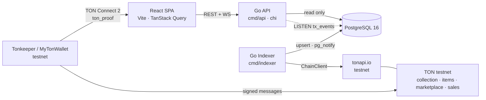
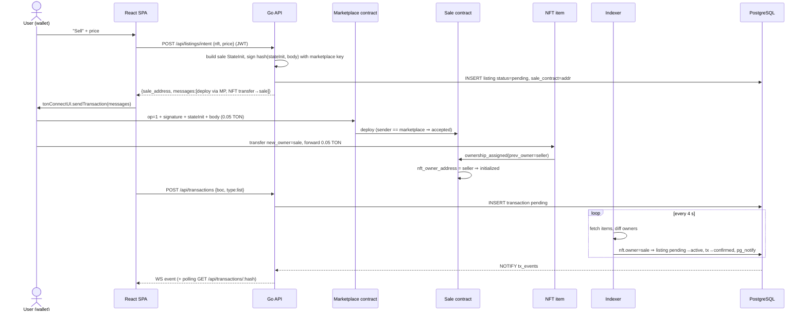
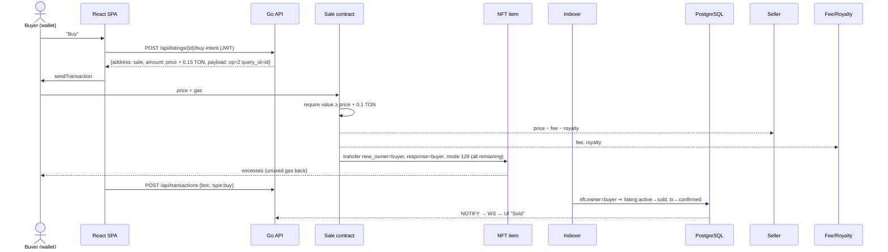

# Architecture

## Module layout (Go, clean architecture)

| Package | Responsibility | May import |
|---|---|---|
| `cmd/api`, `cmd/indexer` | wiring, config, graceful shutdown | everything below |
| `internal/http` | handlers, DTOs, validation, JWT middleware, WS hub | domain, repo (through interfaces), auth |
| `internal/indexer` | sync loop, reconcile, tx tracker | domain, chain, repo interfaces |
| `internal/domain` | entities, listing state machine, intent builders' rules | nothing internal |
| `internal/chain` | `Client` interface + chain-neutral types | — |
| `internal/chain/ton` | tonapi implementation, address normalization, cell builders, ton_proof | chain, tonutils-go |
| `internal/repo` | pgx repositories, migrations | domain |

Dependencies point inward; `internal/domain` has no imports from the other packages.

## Listing flow

## Buy flow

## Indexer loop

1. For every tracked collection: `GetCollection` → upsert metadata, `next_item_index`.
2. Page through `GetCollectionItems`; for every item whose owner differs from the DB → emit
   `OwnerChanged{nft, from, to}` and apply it through the domain state machine:
   - owner == `listings.sale_contract` (pending) → `active`
   - listing active and owner == seller → `cancelled`; any other owner → `sold`
   - matching pending `transactions` → `confirmed`.
3. `GetTransactions(collection, after_lt=cursor)` → record mint/transfer rows → advance `indexer_cursor`.
4. Pending transactions older than `TX_PENDING_TTL` with no owner change → `failed`.
5. Every `ITEM_SCAN_INTERVAL` scan each item's transactions for history; owners are reconciled from the collection item list on every round (safety net against missed changes).

Every step is idempotent: upserts keyed by address/hash; state transitions reject invalid moves
instead of double-applying them. Restarting the indexer mid-loop is safe.

## Address handling

- Stored and compared in **raw** form (`0:hex`, lowercase) — the only canonical form.
- Returned to clients as both `raw` and user-friendly `address` (base64url, bounceable, testnet flag on
  testnet). Wallet addresses are rendered non-bounceable in the UI where appropriate.
- Every inbound address is parsed with tonutils-go `address.ParseAddr`/`ParseRawAddr` and normalized.
